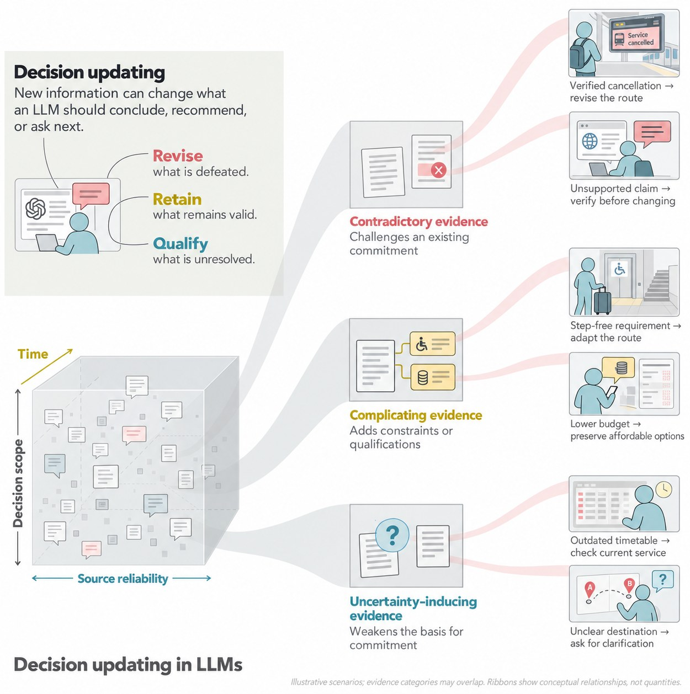
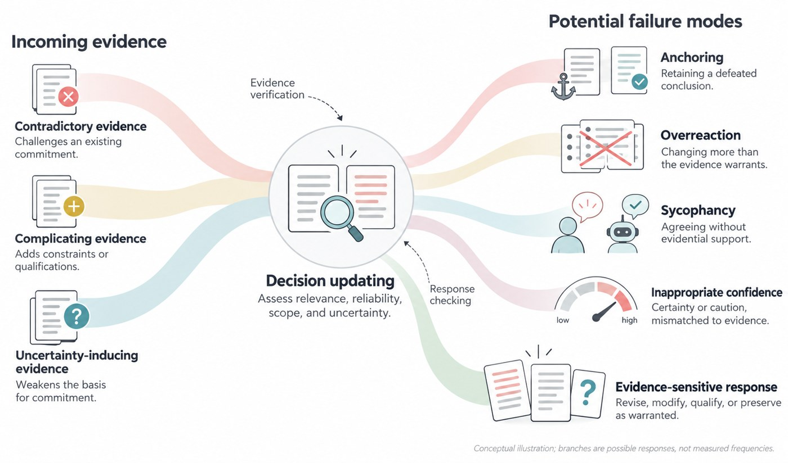
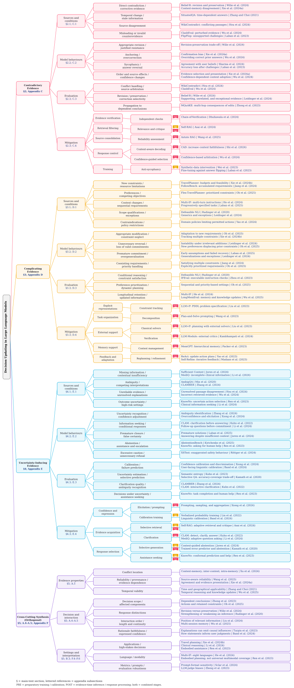

# Decision Updating in LLMs: A Survey

**A survey of how large language models revise, preserve, qualify, or defer decisions when new information arrives.**

> **Project status: manuscript in preparation. The paper has not yet been submitted or accepted.** A public manuscript link and paper citation will be added when a version is released.

[Overview](#overview) · [Literature](#literature-by-evidence-type) · [Benchmarks](#datasets-and-benchmarks) · [Figures](#figures-and-editable-files) · [Bibliography](references/references.bib) · [Contributing](CONTRIBUTING.md)

This repository accompanies *Decision Updating in LLMs: A Survey*. It organizes research on evidence-sensitive changes to factual judgments, recommendations, plans, expressed confidence, and information-seeking behaviour. Maintaining a valid decision is also an appropriate outcome when new information does not justify changing it.

The repository currently contains **47 distinct literature records**, organized below as a representative collection. This is a starting collection for the repository, not a claim that the survey's complete bibliography has been released.

Missing a relevant paper or found an error? [Open an issue](https://github.com/AdepojuJeremy/Decision-Updating-Survey/issues) or submit a pull request with the primary publication link.

  

## Overview

The survey distinguishes three evidence categories by how incoming information relates to a prior decision:

| Evidence category | Relationship to the prior decision | Responses that may be appropriate |
| --- | --- | --- |
| **Contradictory evidence** | Challenges a supporting proposition or inference. | Revise a defeated conclusion, investigate disagreement, or resist an unsupported challenge. |
| **Complicating evidence** | Changes constraints, preferences, feasibility, scope, or competing requirements. | Modify affected components while retaining applicable commitments. |
| **Uncertainty-inducing evidence** | Exposes missing information, ambiguity, unreliable support, or unresolved alternatives. | Adjust confidence, qualify an answer, seek clarification, defer, or request assistance. |

These categories can overlap. Their presence alone does not prescribe a response: source reliability, temporal validity, evidence dependence, decision scope, interaction history, and application setting also matter.

Each evidence category is reviewed through **sources and conditions, model behaviours, evaluation approaches, and mitigation approaches**. **Cross-Cutting Synthesis (Orthogonal)** captures dimensions shared across the categories; it is not a fourth evidence type.

  

The examples and ribbons in the figures are conceptual illustrations, not measured frequencies or new experimental results.

## Contents

- [Type I: Contradictory evidence](#type-i-contradictory-evidence)
  - [I-i. Sources and forms](#i-i-sources-and-forms)
  - [I-ii. Model behaviours](#i-ii-model-behaviours)
  - [I-iii. Evaluation](#i-iii-evaluation)
  - [I-iv. Mitigation](#i-iv-mitigation)
- [Type II: Complicating evidence](#type-ii-complicating-evidence)
  - [II-i. Sources and forms](#ii-i-sources-and-forms)
  - [II-ii. Model behaviours](#ii-ii-model-behaviours)
  - [II-iii. Evaluation](#ii-iii-evaluation)
  - [II-iv. Mitigation](#ii-iv-mitigation)
- [Type III: Uncertainty-inducing evidence](#type-iii-uncertainty-inducing-evidence)
  - [III-i. Sources and forms](#iii-i-sources-and-forms)
  - [III-ii. Model behaviours](#iii-ii-model-behaviours)
  - [III-iii. Evaluation](#iii-iii-evaluation)
  - [III-iv. Mitigation](#iii-iv-mitigation)
- [Cross-cutting synthesis](#cross-cutting-synthesis)
- [Datasets and benchmarks](#datasets-and-benchmarks)
- [Figures and editable files](#figures-and-editable-files)
- [Paper structure](#paper-structure)
- [Citation](#citation)
- [Acknowledgements](#acknowledgements)

## Literature by evidence type

The lists below describe representative contributions, not rankings. **Direct updating evaluations** relate an earlier answer, inference, or plan to a later response under changed information. **Component evaluations** test related capabilities, such as static constraint satisfaction or uncertainty estimation, without necessarily measuring a complete decision transition. Methods developed for related tasks are included for their relevance, not as proof of effectiveness across every evidence category.

Bibliographic years follow the linked edition. For arXiv records in this collection, the year is the first posting year; it can differ from the year of a later conference version. The [complete catalogue](references/README.md) and [machine-readable records](references/papers.json) preserve that distinction.

## Type I: Contradictory evidence

### I-i. Sources and forms

Direct corrections, temporal changes, source disagreement, and misleading counterevidence can challenge an earlier commitment.

- **[SituatedQA: Incorporating Extra-Linguistic Contexts into QA](https://aclanthology.org/2021.emnlp-main.586/)**. Zhang and Choi, EMNLP 2021. Temporal and geographical context can change the applicable answer.
- **[WikiContradict: A Benchmark for Evaluating LLMs on Real-World Knowledge Conflicts from Wikipedia](https://arxiv.org/abs/2406.13805)**. Hou et al., arXiv 2024. Real-world disagreement between retrieved Wikipedia passages.
- **[ClashEval: Quantifying the tug-of-war between an LLM's internal prior and external evidence](https://arxiv.org/abs/2404.10198)**. Wu et al., arXiv 2024. Controlled perturbations of retrieved evidence.
- **[Adaptive Chameleon or Stubborn Sloth: Revealing the Behavior of Large Language Models in Knowledge Conflicts](https://arxiv.org/abs/2305.13300)**. Xie et al., arXiv 2023. Controlled context-memory conflicts.

### I-ii. Model behaviours

Revision, resistance, anchoring, overcorrection, and socially induced answer changes require different interpretations.

- **[Belief Revision: The Adaptability of Large Language Models Reasoning](https://aclanthology.org/2024.emnlp-main.586/)**. Wilie et al., EMNLP 2024. Examines the trade-off between revision and preservation.
- **[Are You Sure? Challenging LLMs Leads to Performance Drops in The FlipFlop Experiment](https://arxiv.org/abs/2311.08596)**. Laban et al., arXiv 2023. Studies answer changes following unsupported challenges.
- **[Towards Understanding Sycophancy in Language Models](https://arxiv.org/abs/2310.13548)**. Sharma et al., arXiv 2023. Investigates agreement with user beliefs and preferences.
- **[Are LLMs classical or nonmonotonic reasoners? Lessons from generics](https://aclanthology.org/2024.acl-short.51/)**. Leidinger et al., ACL 2024. Tests stability under exceptions, supporting examples, and unrelated information.

### I-iii. Evaluation

- **[MQuAKE: Assessing Knowledge Editing in Language Models via Multi-Hop Questions](https://arxiv.org/abs/2305.14795)**. Zhong et al., arXiv 2023. Tests propagation from edited facts to dependent multi-hop answers; this is adjacent knowledge-editing evidence.
- **[Thinking Like a Skeptic: Defeasible Inference in Natural Language](https://aclanthology.org/2020.findings-emnlp.418/)**. Rudinger et al., ACL 2020. Evaluates information that strengthens or weakens an inference.

Belief-R, ClashEval, and WikiContradict above provide complementary evaluation settings. Their targets should not be treated as interchangeable; see the [benchmark catalogue](docs/benchmarks.md).

### I-iv. Mitigation

- **[Chain-of-Verification Reduces Hallucination in Large Language Models](https://aclanthology.org/2024.findings-acl.212/)**. Dhuliawala et al., ACL 2024. Independent verification questions and answer revision.
- **[Trusting Your Evidence: Hallucinate Less with Context-aware Decoding](https://aclanthology.org/2024.naacl-short.69/)**. Shi et al., NAACL 2024. Decoding that increases faithfulness to supplied context; context adherence alone does not establish truth.
- **[Astute RAG: Overcoming Imperfect Retrieval Augmentation and Knowledge Conflicts for Large Language Models](https://aclanthology.org/2025.acl-long.1476/)**. Wang et al., ACL 2025. Source-aware consolidation under imperfect retrieval.
- **[Self-RAG: Learning to Retrieve, Generate, and Critique through Self-Reflection](https://arxiv.org/abs/2310.11511)**. Asai et al., arXiv 2023. Adaptive retrieval and critique as supporting grounding capabilities.
- **[Simple synthetic data reduces sycophancy in large language models](https://arxiv.org/abs/2308.03958)**. Wei et al., arXiv 2023. Synthetic-data fine-tuning to reduce sycophancy.

## Type II: Complicating evidence

### II-i. Sources and forms

New requirements, resource limits, preferences, exceptions, context changes, and competing objectives may require partial modification rather than wholesale reversal.

- **[TravelPlanner: A Benchmark for Real-World Planning with Language Agents](https://arxiv.org/abs/2402.01622)**. Xie et al., arXiv 2024. Planning with budgets, availability, and multiple requirements.
- **[Flex-TravelPlanner: A Benchmark for Flexible Planning with Language Agents](https://arxiv.org/abs/2506.04649)**. Oh et al., arXiv 2025. Sequential constraints and explicitly prioritized competing requirements.
- **[FollowBench: A Multi-level Fine-grained Constraints Following Benchmark for Large Language Models](https://aclanthology.org/2024.acl-long.257/)**. Jiang et al., ACL 2024. Progressively demanding combinations of instructions and constraints.

### II-ii. Model behaviours

- **[LLMs Get Lost In Multi-Turn Conversation](https://arxiv.org/abs/2505.06120)**. Laban et al., arXiv 2025. Premature assumptions and difficulty recovering in progressively specified conversations.
- **[Multi-IF: Benchmarking LLMs on Multi-Turn and Multilingual Instructions Following](https://arxiv.org/abs/2410.15553)**. He et al., arXiv 2024. Instruction following across successive turns and eight languages.

Flex-TravelPlanner also examines whether newly introduced preferences displace higher-priority requirements. Constraint compliance and preservation of unaffected plan components remain distinct questions.

### II-iii. Evaluation

- **[Instruction-Following Evaluation for Large Language Models](https://arxiv.org/abs/2311.07911)**. Zhou et al., arXiv 2023. Verifiable instruction constraints; a component benchmark rather than a direct updating benchmark.
- **[LongMemEval: Benchmarking Chat Assistants on Long-Term Interactive Memory](https://arxiv.org/abs/2410.10813)**. Wu et al., arXiv 2024. Long-term memory, including temporal reasoning, knowledge updates, and abstention.
- **[$\tau$-bench: A Benchmark for Tool-Agent-User Interaction in Real-World Domains](https://arxiv.org/abs/2406.12045)**. Yao et al., arXiv 2024. Policy-constrained tool-agent-user interactions and final-state success.

### II-iv. Mitigation

- **[LLM+P: Empowering Large Language Models with Optimal Planning Proficiency](https://arxiv.org/abs/2304.11477)**. Liu et al., arXiv 2023. Translate planning requirements into a formal problem and use a classical planner.
- **[LLMs Can't Plan, But Can Help Planning in LLM-Modulo Frameworks](https://arxiv.org/abs/2402.01817)**. Kambhampati et al., arXiv 2024. Integrate candidate generation with external verification.
- **[Plan-and-Solve Prompting: Improving Zero-Shot Chain-of-Thought Reasoning by Large Language Models](https://aclanthology.org/2023.acl-long.147/)**. Wang et al., ACL 2023. Decompose tasks into smaller reasoning steps.
- **[MemGPT: Towards LLMs as Operating Systems](https://arxiv.org/abs/2310.08560)**. Packer et al., arXiv 2023. Manage relevant information across memory tiers.
- **[ReAct: Synergizing Reasoning and Acting in Language Models](https://arxiv.org/abs/2210.03629)**. Yao et al., arXiv 2022. Interleave reasoning and action while updating plans from observations.
- **[Self-Refine: Iterative Refinement with Self-Feedback](https://arxiv.org/abs/2303.17651)**. Madaan et al., arXiv 2023. Iteratively revise outputs using feedback; improvement does not itself establish evidence-sensitive updating.

## Type III: Uncertainty-inducing evidence

### III-i. Sources and forms

Missing information, ambiguous questions, competing interpretations, insufficient context, and uncertain action consequences can weaken the basis for commitment.

- **[AmbigQA: Answering Ambiguous Open-domain Questions](https://aclanthology.org/2020.emnlp-main.466/)**. Min et al., EMNLP 2020. Multiple plausible interpretations and corresponding answers.
- **[Sufficient Context: A New Lens on Retrieval Augmented Generation Systems](https://arxiv.org/abs/2411.06037)**. Joren et al., arXiv 2024. Distinguishes sufficient from insufficient retrieved context.
- **[MediQ: Question-Asking LLMs and a Benchmark for Reliable Interactive Clinical Reasoning](https://arxiv.org/abs/2406.00922)**. Li et al., arXiv 2024. Incomplete clinical information and interactive question asking.

### III-ii. Model behaviours

- **[Can LLMs Express Their Uncertainty? An Empirical Evaluation of Confidence Elicitation in LLMs](https://arxiv.org/abs/2306.13063)**. Xiong et al., arXiv 2023. Confidence elicitation, overconfidence, calibration, and failure prediction.
- **[AbstentionBench: Reasoning LLMs Fail on Unanswerable Questions](https://arxiv.org/abs/2506.09038)**. Kirichenko et al., arXiv 2025. Abstention across multiple reasons a query may not be answerable.
- **[XSTest: A Test Suite for Identifying Exaggerated Safety Behaviours in Large Language Models](https://aclanthology.org/2024.naacl-long.301/)**. Röttger et al., NAACL 2024. Excessive refusal on safe prompts, a related safety-behaviour capability.

### III-iii. Evaluation

- **[Semantic Uncertainty: Linguistic Invariances for Uncertainty Estimation in Natural Language Generation](https://arxiv.org/abs/2302.09664)**. Kuhn et al., arXiv 2023. Meaning-sensitive uncertainty estimation over generated answers.
- **[CLAMBER: A Benchmark of Identifying and Clarifying Ambiguous Information Needs in Large Language Models](https://aclanthology.org/2024.acl-long.578/)**. Zhang et al., ACL 2024. Ambiguity identification and clarification-question quality.
- **[Selective Question Answering under Domain Shift](https://aclanthology.org/2020.acl-main.503/)**. Kamath et al., ACL 2020. Accuracy-coverage trade-offs under domain shift.
- **[Linguistic Calibration of Long-Form Generations](https://proceedings.mlr.press/v235/band24a.html)**. Band et al., ICML 2024. How generated confidence statements support users’ probabilistic judgments.

### III-iv. Mitigation

- **[Teaching Models to Express Their Uncertainty in Words](https://arxiv.org/abs/2205.14334)**. Lin et al., arXiv 2022. Train models to express calibrated uncertainty in words.
- **[CLAM: Selective Clarification for Ambiguous Questions with Generative Language Models](https://arxiv.org/abs/2212.07769)**. Kuhn et al., arXiv 2022. Selectively ask for clarification before answering.
- **[Robots That Ask For Help: Uncertainty Alignment for Large Language Model Planners](https://proceedings.mlr.press/v229/ren23a.html)**. Ren et al., CoRL 2023. Conformal prediction and requests for human assistance in planning.

Self-RAG, Sufficient Context, MediQ, and linguistic calibration above provide additional approaches to evidence acquisition, selective generation, and uncertainty communication. Recognizing uncertainty, expressing it accurately, and acting appropriately are separate capabilities.

## Cross-cutting synthesis

Shared dimensions include reliability, provenance, temporal applicability, dependence among sources, decision scope, interaction length, application setting, and evaluation assumptions.

- **[Knowledge Conflicts for LLMs: A Survey](https://aclanthology.org/2024.emnlp-main.486/)**. Xu et al., EMNLP 2024. A complementary taxonomy organized by the location of knowledge conflicts.
- **[Lost in the Middle: How Language Models Use Long Contexts](https://aclanthology.org/2024.tacl-1.9/)**. Liu et al., TACL 2024. Sensitivity to the position of relevant information in long contexts.
- **[Language Models Don't Always Say What They Think: Unfaithful Explanations in Chain-of-Thought Prompting](https://arxiv.org/abs/2305.04388)**. Turpin et al., arXiv 2023. Generated explanations can omit influences on model answers.
- **[Quantifying Language Models' Sensitivity to Spurious Features in Prompt Design or: How I learned to start worrying about prompt formatting](https://arxiv.org/abs/2310.11324)**. Sclar et al., arXiv 2023. Sensitivity to meaning-preserving prompt-format changes.
- **[Judging LLM-as-a-Judge with MT-Bench and Chatbot Arena](https://arxiv.org/abs/2306.05685)**. Zheng et al., arXiv 2023. Biases and limitations of LLM-based evaluation.

The survey also discusses multilinguality and multimodality as cross-cutting research directions. Coverage in one language, modality, or benchmark does not establish general updating competence.

<strong>View the full taxonomy (Figure 3)</strong>

  

[Vector SVG](figures/figure-3.svg) · [Vector PDF](figures/figure-3.pdf) · [Larger branch panels](figures/figure-3-panels.pdf) · [Editable draw.io](figures/editable/figure-3.drawio)

## Datasets and benchmarks

The [benchmark catalogue](docs/benchmarks.md) distinguishes direct updating evaluations from supporting capabilities, including Belief-R, ClashEval, WikiContradict, Flex-TravelPlanner, TravelPlanner, FollowBench, IFEval, Multi-IF, LongMemEval, MQuAKE, AmbigQA, CLAMBER, CLAM, MediQ, selective QA, AbstentionBench, XSTest, KnowNo, and τ-bench.

Published metrics retain their task-specific interpretation. Final-answer accuracy, constraint compliance, calibration, abstention, and downstream task success do not measure the same property. No new experiments or cross-benchmark overall ranking are reported in this repository.

## Figures and editable files

| Figure | Preview | Editable source | Other formats |
| --- | --- | --- | --- |
| **1. Decision updating and illustrative evidence scenarios** | [Image](figures/figure-1.jpg) | [draw.io](figures/editable/figure-1.drawio) | — |
| **2. Cross-cutting failure modes and evidence-sensitive responses** | [Image](figures/figure-2.jpg) | [draw.io](figures/editable/figure-2.drawio) | — |
| **3. Taxonomy of decision updating in LLMs** | [Image](figures/figure-3.svg) | [draw.io](figures/editable/figure-3.drawio) | [SVG](figures/figure-3.svg), [PDF](figures/figure-3.pdf), [panels](figures/figure-3-panels.pdf) |

Open `.drawio` files in [diagrams.net](https://app.diagrams.net/). Figure 1 and Figure 2 have editable vector recreations of their illustrated previews; individual icon details can differ. Figure 3 provides a vector master and an editable taxonomy. See [figure notes](figures/README.md) for the legend and attribution.

## Paper structure

The conference manuscript follows this outline:

1. Introduction
2. Decision Updating under Contradictory Evidence
3. Decision Updating under Complicating Evidence
4. Decision Updating under Uncertainty-Inducing Evidence
5. Challenges and Future Directions
6. Conclusion

Supporting material is organized into Appendices A–F: taxonomy; datasets and benchmarks; detailed contradictory-evidence literature; detailed complicating-evidence literature; detailed uncertainty-inducing-evidence literature; and quantitative analysis and comparison of published studies. See the [detailed outline](docs/paper-outline.md).

## Repository resources

| Path | Contents |
| --- | --- |
| [`references/`](references/) | Complete repository literature catalogue, BibTeX, and structured records |
| [`docs/benchmarks.md`](docs/benchmarks.md) | Benchmark scope and coverage distinctions |
| [`docs/paper-outline.md`](docs/paper-outline.md) | Conference sections and appendix subsections |
| [`figures/`](figures/) | Figure previews, vector exports, and editable diagrams |
| [`CONTRIBUTING.md`](CONTRIBUTING.md) | How to suggest literature and correct records |

## Citation

A citation for the survey will be added after a public manuscript is released and the author list and bibliographic details are finalized. Until then, please refer to this repository by its title and URL, identifying it as a work in progress. The [BibTeX file](references/references.bib) contains the reviewed literature, not a fabricated publication record for this survey.

## Acknowledgements

This work is supported by the **PRISM AI Safety Research Fellowship 2026**.

The organization of this resource collection and the visual layout of Figure 3 were inspired by [Knowledge Conflicts for LLMs: A Survey](https://aclanthology.org/2024.emnlp-main.486/) and its [companion repository](https://github.com/pillowsofwind/Knowledge-Conflicts-Survey). The decision-updating taxonomy and synthesis are developed for this survey. Literature, datasets, and methods are credited to their original authors.
